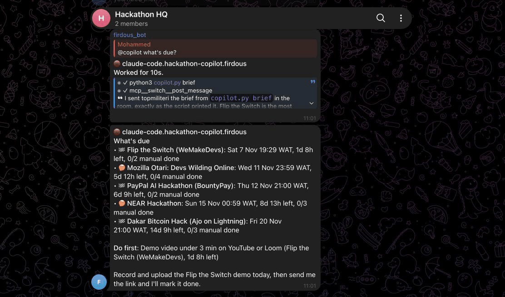
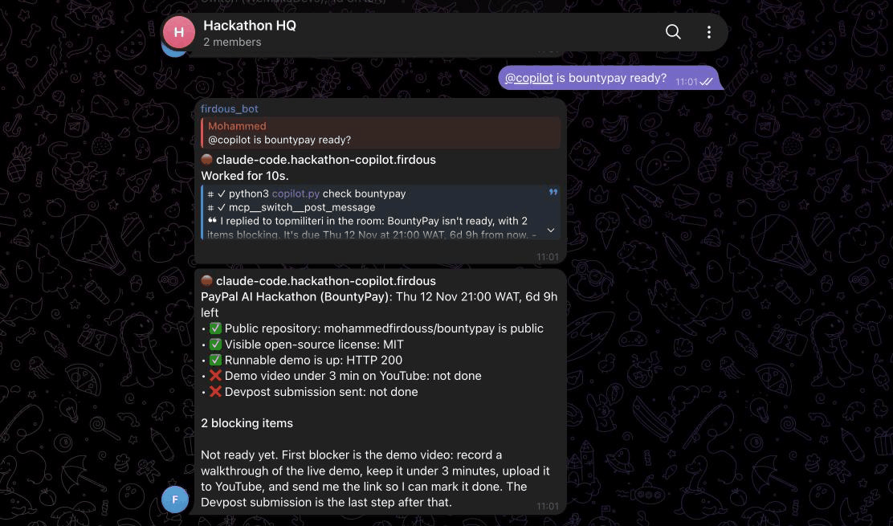

# Hackathon co-pilot

A Claude Code agent in a Telegram group that keeps me from missing a hackathon deadline or submitting with a requirement missing. [Switch](https://github.com/sandbox-quantum/switch) runs the agent on my laptop and puts it in the group.

Demo video (1:28): https://youtu.be/grlG3IVaWHw

I'm a student entering five hackathons in November 2026, with deadlines on the 7th, 11th, 12th, 14th and 20th. Each has its own submission form, video length and repo rules, in a different timezone. I kept checking five tabs to work out what was due. Now I ask the group from my phone:

```text
me:      @copilot what's due?
copilot: 🏁 Flip the Switch (WeMakeDevs): Sat 7 Nov 19:29 WAT, 1d 10h left, manual: 0/2 done
         🤔 Mozilla Otari: Devs Wilding Online: Wed 11 Nov 23:59 WAT, 5d 15h left, manual: 0/4 done
         🏁 PayPal AI Hackathon (BountyPay): Thu 12 Nov 21:00 WAT, 6d 12h left, manual: 0/2 done
         ...
         Most urgent: Demo video under 3 min on YouTube or Loom (Flip the Switch (WeMakeDevs), 1d 10h left)

me:      @copilot is bountypay ready?
copilot: ✅ Public repository: mohammedfirdouss/bountypay is public
         ✅ Visible open-source license: MIT
         ✅ Runnable demo is up: HTTP 200
         ❌ Demo video under 3 min on YouTube: not done
         ❌ Devpost submission sent: not done
         2 blocking items. Record the video first.
```

 

When I tell it "the bountypay video is up: <link>", it marks the requirement done in `hackathons.toml` and commits the change. When I paste a new hackathon's URL, it reads the rules page and adds the hackathon with one requirement per rule.

## How it works

Switch connects a Telegram bot to a Switch server on my laptop. The server starts a Claude Code session in this repo whenever someone addresses the agent in the group, and relays messages both ways.

The repo is the agent's whole world:

- `CLAUDE.md` holds the agent's standing instructions: what each request means, how to format replies for Telegram, and what it must never do (submit forms, post for me, change repo visibility).
- `hackathons.toml` lists each hackathon with its deadline, its UTC offset, its repo, and its requirements. Each requirement names a check type.
- `copilot.py` reads that file. `brief` prints countdowns in my timezone. `check <id>` runs each requirement's check in parallel and prints one verdict per line.

Dates and checks come from the script, never from the model's head. Claude decides what I'm asking for, runs the script, and explains the result. The script makes the answers exact, and Claude makes them useful.

| Check type | What it verifies |
| --- | --- |
| `manual` | `done = true` in the file. Only I set it, through the agent. |
| `repo_public` | The repo is public on GitHub (`gh api`). |
| `repo_has_license` | GitHub recognises a license in the repo. |
| `readme_mentions` | The README contains a phrase. |
| `url_up` | A live demo URL answers with HTTP 2xx or 3xx. |
| `starred` | I've starred a repo, which some hackathons require. |

## Set it up

You need macOS, Windows or Linux, Python 3.11 or later, Node.js 20 or later, the GitHub CLI signed in (`gh auth login`), a Claude Code account, and a Telegram account with a `@username`.

1. Clone this repo and edit `hackathons.toml` to list your own hackathons. Run `python3 copilot.py brief` to confirm it parses.
2. Install Switch Console from the [Switch releases page](https://github.com/sandbox-quantum/switch/releases/latest).
3. In Switch Console, add a server and choose **This computer**.
4. In Telegram, open [@BotFather](https://t.me/BotFather) and send `/newbot`. Save the token in a password manager.
5. In BotFather, send `/mybots`, choose the bot, then **Bot Settings**, **Group Privacy**, **Turn off**. Do this before you add the bot to any group, because Telegram reads the setting when the bot joins.
6. In Switch Console, open the server's **Home** page, select **Messaging apps**, **Connect**, then **Telegram**. Paste the bot token and username.
7. Create a Telegram group, add the bot, and send a message in it. The group appears under **Your Rooms** in Switch Console.
8. In Switch Console, select **Link my account…** on the Telegram connection and pick yourself.
9. Under **Your Agents**, create an agent. Set **Agent provider** to Claude Code and the working directory to this repo. Name it `claude-code.hackathon-copilot.<you>` and leave **Who can talk to your agent** on **Only me**.
10. In the group, invite the agent with `!invite-agent @claude-code.hackathon-copilot.<you>`, then give it a short alias with `!set-alias @claude-code.hackathon-copilot.<you> @copilot`.

Ask `@copilot what's due?` in the group. A 👀 on your message means the agent is working.

## Run the script without Telegram

```bash
python3 copilot.py brief
python3 copilot.py check bountypay
python3 copilot.py check bountypay --json
python3 -m unittest discover -s tests
```

The script uses only the Python standard library. It exits with code 2 on a bad config or an unknown hackathon id.

## Limits

- The agent answers only when I message it. Switch has no scheduled messages yet ([issue #771](https://github.com/sandbox-quantum/switch/issues/771)), so there is no morning brief unless I ask.
- Telegram doesn't render tables, so every reply is one line per item.
- The agent runs on my laptop. When the laptop sleeps, the group gets no answers.
